# Moment

**A calm Android home screen with one living companion that gives you what this moment needs and hides the rest.**

Built solo for the [Meta Global AI Developer Hackathon](https://cerebralvalley.ai/e/meta-ai-developer-hackathon) · Indie track · *Build for Your World*.
Powered by **Muse Spark**, **Muse Image** and **Muse Voice Transcribe** through Meta Model API.

> 🎬 Demo video: _link coming_

<p>
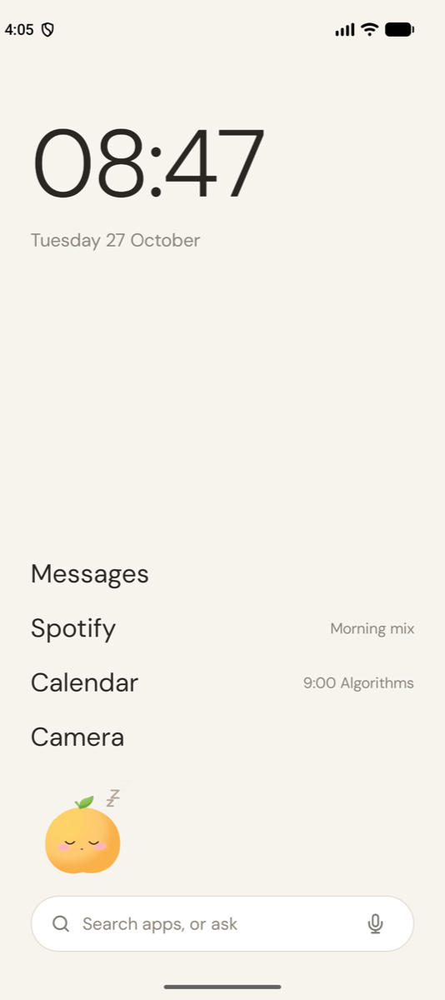
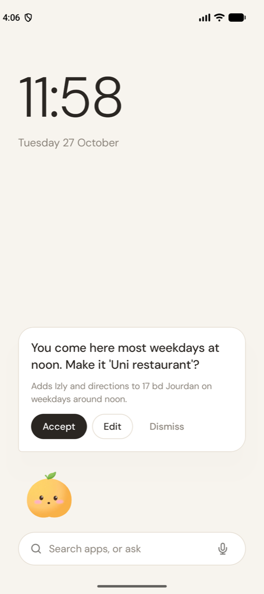
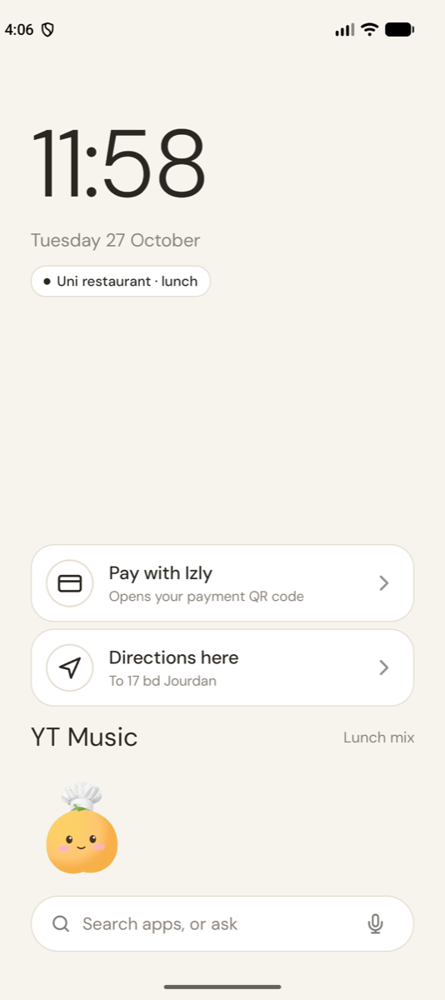
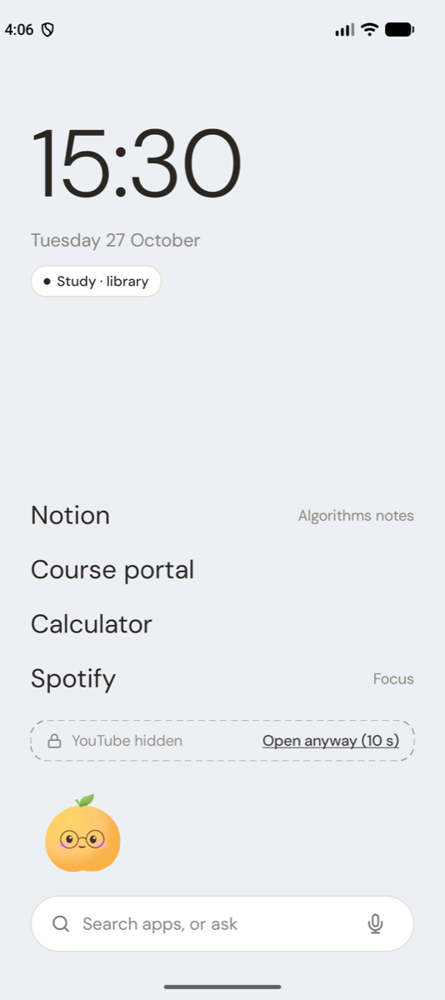
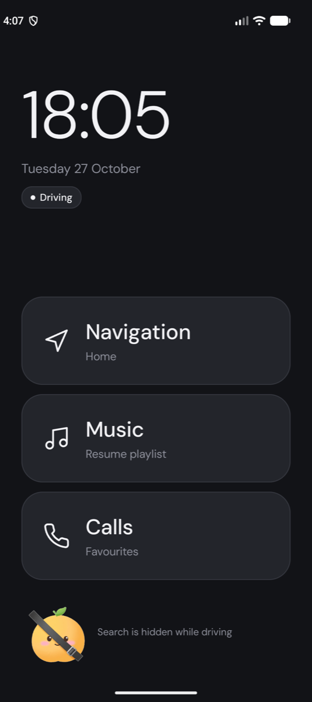
</p>
<p>
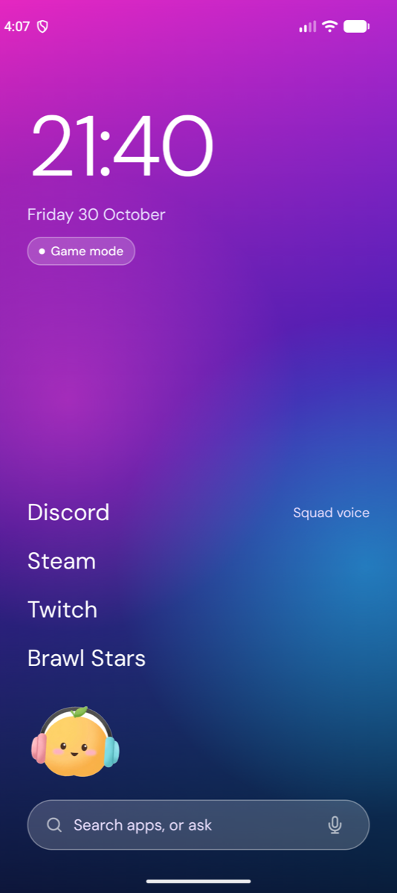
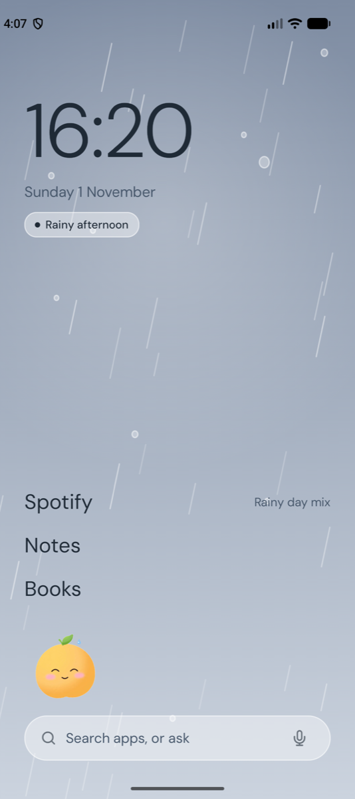
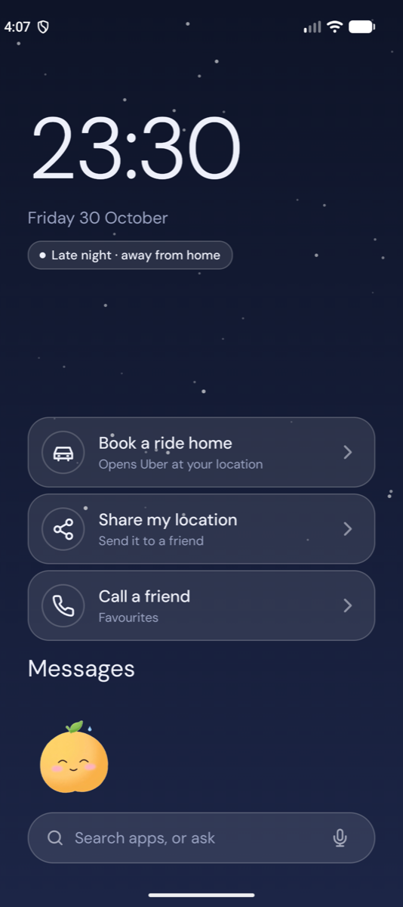
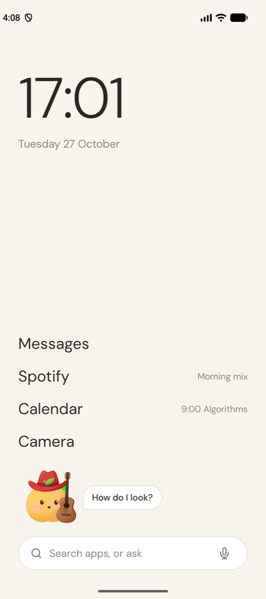
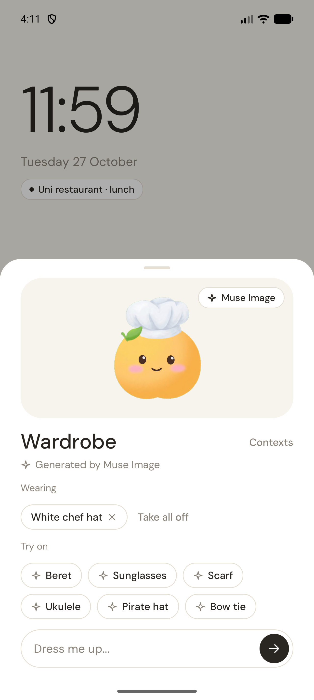
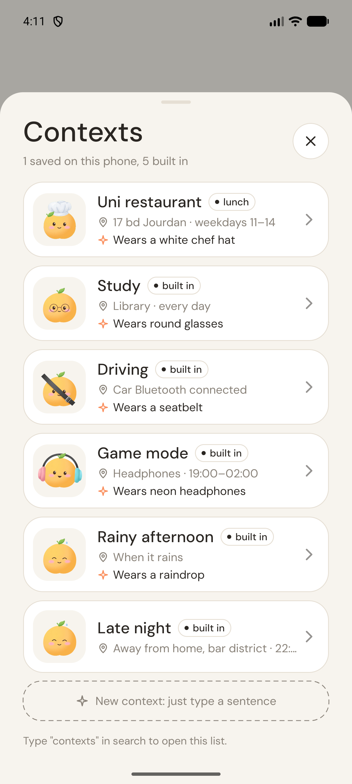
</p>

## The problem

Your home screen looks the same at the uni restaurant, in the car and at 1 a.m. outside a bar. Thirty icons, every time. Built-in launchers suggest *apps*; none of them hides anything, and none of them tells you why.

## What Moment does

The home screen holds four things: a clock, a companion, at most four rows for *this moment*, and search. Everything else lives behind search.

| Moment | What you see |
|---|---|
| Uni restaurant, noon | **Pay with Izly** and **Directions to 17 bd Jourdan**, one tap each |
| Library | Notion, course portal, calculator. Distracting apps are hidden; "Open anyway" makes you wait 10 s |
| Car Bluetooth connects | Three big buttons: Navigation, Music, Calls. Search disappears |
| 23:30, away from home | Book a ride home, share my location, call a friend |
| Headphones, evening | Game mode: Discord, Steam, Twitch |
| Rain | Something cozy |

**The companion is the only face of the AI.** It sleeps most of the time. When it notices a pattern ("you come here most weekdays at noon") it wakes up and proposes a context on a card you **Accept**, **Edit** or **Dismiss**. Nothing on your home screen changes without your OK, and two dismissals in a row make it go quiet.

**Talk to it** by typing or holding the mic. It's an **agent**: *"I go to the gym on Tuesday and Thursday evenings, and I play guitar"* makes it check the time, your contexts and your apps, remember that you play guitar, and stage two contexts (Gym · Tue, Thu · 17–21h, YouTube hidden; Guitar time · headphones) on **one card you approve**. *"Open YouTube"* opens YouTube. *"Put on a cowboy hat"* … it puts on a cowboy hat.

**Real signals:** headphones and car Bluetooth come from Android's audio devices. **Live weather** comes from Muse Spark with web search: when it really rains in Paris, Moment goes into rain mode on its own and shows "Light rain, 5°C" next to the date.

**Wardrobe & postcards:** long-press the companion to open its wardrobe (what it wears, try-on suggestions, "Dress me up…"). **Share** asks Muse Image to paint a postcard of your companion, dressed as it is, in a scene for the current moment, ready to post.

**Contexts list:** type "contexts" to see every context with its trigger and the outfit the companion wears there.

## How Meta's models are used

| Model | Where | What it does |
|---|---|---|
| **Muse Spark agent** (tool calling) | `ai/Agent.kt` | Real OpenAI-style tool calling, up to 6 turns, parallel calls: `get_now`, `list_contexts`, `list_apps`, `propose_context`, `delete_context`, `open_app`, `wear`, `undress`, `remember`, `share_postcard`. Read-only and harmless tools run immediately; changes to the home screen are **staged** into one plan card. Remembered facts feed the next conversations. |
| **Muse Spark + web_search** | `ai/Weather.kt` | Search grounding through the Responses API with a JSON schema: rain now / rain in 3 h / temperature / summary. Only the city name is sent. |
| **Muse Spark** `muse-spark-1.3` | `ai/MuseJobs.kt` | One JSON-schema-constrained call per interaction (structured output, `reasoning_effort: minimal`, ~3–6 s). It turns a detected pattern or any sentence into one of five intents: a **context** (name, chip, trigger, ≤4 apps/actions, apps to hide, companion mood, palette, greeting, outfit), **open_app**, **dress**, **undress** or **answer**. It also sorts installed apps once (distracting, transport, payment…) so Focus knows what to hide. |
| **Muse Image** `muse-image-1.0` | `art/generate_companion.sh`, `ai/Outfits.kt` | Generated the companion, its 8 expressions and four **faceless rig bodies** (plain, glasses, headphones, seatbelt) by *editing* one base image, so the character stays identical. **At runtime**, accepting a context or asking "play the guitar" sends the current body to `/images/edits`; the result is cut out on the phone (green-screen key + de-spill) and **stacks**: hat, then guitar, then sunglasses. **Postcards** (`ai/Postcard.kt`): the dressed companion, given a face, painted into a scene for the current moment. |
| **Muse Voice Transcribe** `muse-voice-transcribe-1.0` | `ai/Voice.kt` | Push-to-talk on the mic button: 16 kHz WAV to `/asr/transcribe` in `PUSH_TO_TALK` mode, with the user's **installed app names as vocabulary keywords** and English + French language bias. |

### The living companion (rig)

The companion is not a GIF. Muse Image drew the body without a face; `ui/Companion.kt` draws the face **every frame** at 60 fps:

- blinks on a random schedule (and sometimes twice),
- eyes that glance around, read lines (glasses), check mirrors (driving), or look up while thinking,
- a mouth that moves in syllable-like rhythm whenever it speaks,
- z's that drift up while it sleeps, thinking dots, a raindrop that swells and slides off the leaf,
- breathing squash-and-stretch, nodding at 112 bpm with headphones, a hop with anticipation and landing squash when tapped.

Because the face is live, every Muse Image outfit keeps blinking and talking.

## Privacy by design

**Rules decide *when*, the model decides *what*.** Time, place, Bluetooth and visit counting run on the phone (`data/ContextEngine.kt`) and work offline. Only **labels** ever reach the model: `"17 bd Jourdan"`, `"Tuesday 11:58"`, app names. Never coordinates, never usage history. Every model output lands on a card the user confirms, so a wrong answer costs one tap, not a broken home screen. If Muse is unreachable, a rules-only card is shown instead.

## Architecture

```
signals (time, place label, BT, rain) ──► ContextEngine (rules, on device) ──► active context
                                              │ pattern: 3+ visits, same place & hour
                                              ▼
 typed / spoken sentence ─► Voice (Muse Voice Transcribe) ─► MuseJobs (Muse Spark, JSON schema)
                                              │ context | open_app | dress | undress | answer
                                              ▼
                     Proposal card ─ Accept ─► ContextStore (SharedPreferences, local only)
                                              │ outfit / accessory
                                              ▼
                     Outfits (Muse Image edit ─► on-device green-key cut-out) ─► Companion rig
```

`app/src/main/java/app/moment/launcher/`
- `MomentViewModel.kt`: state, companion behaviour, Muse orchestration
- `data/`: models, rules engine, local store
- `ai/`: Model API client, prompts and schemas, outfits, voice
- `system/Phone.kt`: installed apps and deep-link actions (navigation, rides, sharing, calls, store fallback)
- `ui/`: home screen, companion rig, demo panel. Design tokens come from the Figma mockups (`docs/design-spec.md`)

## Run it

Requirements: Android Studio (JDK 21), Android SDK 36, a Meta Model API key.

```bash
echo "MODEL_API_KEY=your_key" > .env        # gitignored; ../.env also works
./gradlew installDebug
adb shell cmd package set-home-activity app.moment.launcher/.MainActivity
```

**Demo panel:** long-press the clock to fake time, place, car Bluetooth, headphones and rain, seed visits, or re-sort apps.
**Scripted demo** (used to record the video):

```bash
adb shell am start -n app.moment.launcher/.MainActivity --es demo "'reset;seed;clock:2026-10-27-11-58;place:JOURDAN'"
# commands: reset, seed, live, clock:Y-M-D-H-M, place:HOME|JOURDAN|LIBRARY|AWAY|ELSEWHERE,
#           car:1|0, hp:1|0, rain:1|0, tap, ask:<text>, accept, dismiss
```

## Built during the hackathon

Everything in this repository was written during the hackathon (see the commit history). The concept brief and Figma mockups were prepared before coding; all code, prompts, the companion rig and every Muse Image asset were made during the event.

Honest limits: in the demo, place and Bluetooth are faked from the demo panel (the rules engine is real and reads them as signals). Background location and real Bluetooth listeners are the next step.

## License

MIT
